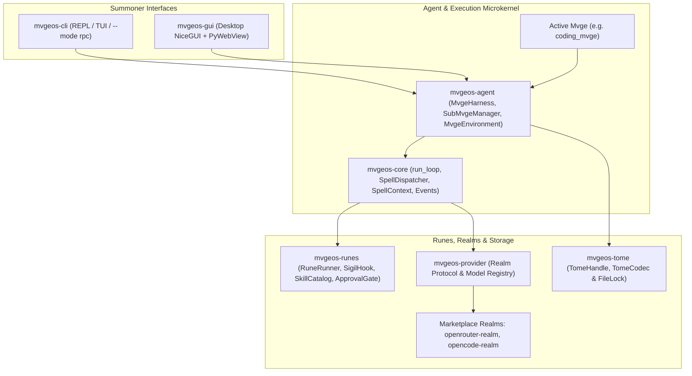

# 🧙‍♂️ MvgeOS

[](https://www.python.org/downloads/)
[](https://github.com/astral-sh/uv)
[](https://github.com/astral-sh/ruff)
[](https://mypy-lang.org/)
[](https://opensource.org/licenses/MIT)
[]()

> **An open coding-agent microkernel and runtime. Read it, fork it, self-host it, and run it on a model you already pay for.**

MvgeOS is an operating system for AI agents, written in Python. A **Mvge** — the
agent — casts **Spells** (tools) against models served by **Realms** (providers).
Conversations persist as **Tomes**. Capabilities extend through **Runes**.

No account to create with MvgeOS. No telemetry in the engine. The default model
(`openrouter/free`) is free of per-token charges, and requires an
`OPENROUTER_API_KEY` because as of 2026-10-11 no free tier anywhere answers an
unauthenticated request ([ADR-0020](docs/adr/0020-no-free-tier-answers-a-stranger.md)).
To use another provider, bring the key for the Realm you want.

## Install

```bash
uv tool install mvgeos
mvgeos --help
```

Or run it without installing anything:

```bash
uvx mvgeos --help
```

> Working from source instead? `uv sync --all-packages` in a clone, then
> `uv run mvgeos --help`. The published distribution is the one the commands
> above install; nothing here needs a clone.

## Run one task

Three commands, after exporting your key. From a free OpenRouter key to a file
on disk:

```bash
# 0. the key — the default free tier needs one since ADR-0020
export OPENROUTER_API_KEY="sk-or-..."

# 1. the Realm — how MvgeOS reaches a model
uvx mvgeos rune install openrouter-realm --confirm-python-deps

# 2. the Mvge — carries the Spells
uvx mvgeos mvge install coding_mvge

# 3. run a task
uvx mvgeos --agent-name coding_mvge "Create a file named hello.txt containing exactly the text: hello from mvgeos"
```

**Why Step 0 is required ([ADR-0020](docs/adr/0020-no-free-tier-answers-a-stranger.md)):**
MvgeOS originally ran with no credential at all when OpenCode Zen served its
free tier anonymously. On 2026-10-11 OpenCode Zen restricted its free endpoints
(`FreeTierError: OpenCode's free tier can only be used from within OpenCode`),
and OpenRouter's `:free` slugs require an API key for caller identification.
The `openrouter/free` model remains free of charge; the key identifies you to
the upstream Realm.

To use another provider or model instead, see
[Bring your own key](#bring-your-own-key).

Commands 1 and 2 both succeed on a machine with an empty `$HOME`:

```text
$ uvx mvgeos rune install openrouter-realm --confirm-python-deps
Successfully installed rune 'openrouter-realm' to ~/.agents/extensions/openrouter-realm

$ uvx mvgeos mvge install coding_mvge
Non-interactive session: skipping install of unreviewed python dependencies
['mvgeos-agent', 'mvgeos-core', 'mvgeos-provider', 'mvgeos-runes'].
Re-run with confirm=True to install.
Successfully installed mvge 'coding_mvge' to ~/.agents/agents/coding_mvge
```

> **Command 2 may ask a question in a real terminal — and answering `n` is fine.**
> `mvge install` gates its declared `python_deps` the way `rune install` does,
> so on a TTY it prompts before fetching. The four packages `coding_mvge` names
> are already installed with the engine, and the resolved Spell set is the same
> nine either way. To pass without prompting, use
> `uvx mvgeos mvge install --confirm-python-deps coding_mvge`.

<details>
<summary>The same run as a terminal recording, on a machine with an empty <code>$HOME</code></summary>


</details>

Here is that task, actually run, with nothing edited. The Mvge cast `write`,
checked its own work with a second Spell, and reported back:

```text
Created hello.txt containing exactly hello from mvgeos — verified byte-for-byte with od -c (17 bytes, no trailing newline).
Stop reason: stop
```

The file is on disk, byte for byte what was asked — 17 characters, and no
trailing newline, because the prompt said *exactly* that text:

```console
$ ls -l hello.txt
-rw-r--r-- 1 you you 17 hello.txt
$ od -c hello.txt
0000000   h   e   l   l   o       f   r   o   m       m   v   g   e   o
0000020   s
0000021
```

The same task in the desktop app:


<details>
<summary>Install and runtime output, from a clean machine</summary>

```text
$ uvx mvgeos --help
 MvgeOS - a Python-based AI coding agent

╭─ Commands ────────────────────────────────────────────────────────────────────╮
│ build   Serialise the resolved runtime manifest (read-only).                 │
│ config  Configuration management                                             │
│ info    Display the runtime snapshot as rich tables (read-only).             │
│ mvge    Mvge (agent) management                                              │
│ rune    Extension rune management                                            │
│ setup   Install system dependencies for runes                                │
│ tome    Session tome management                                              │
╰──────────────────────────────────────────────────────────────────────────────╯

$ uvx mvgeos rune install openrouter-realm --confirm-python-deps
Successfully installed rune 'openrouter-realm' to ~/.agents/extensions/openrouter-realm

$ uvx mvgeos mvge install coding_mvge
Successfully installed mvge 'coding_mvge' to ~/.agents/agents/coding_mvge

$ uvx mvgeos info --agent-name coding_mvge
Agent: coding_mvge
Model: openrouter/free

Spells
  bash        builtin
  edit        builtin
  find        builtin
  grep        builtin
  list_files  builtin
  read        builtin
  read_url    builtin
  search_web  builtin
  write       builtin
```

The `info` table also prints a Description column per Spell, followed by the
Rune, Config, Prompt, Skills, and Diagnostics tables. `mvgeos build
--agent-name coding_mvge` prints the resolved runtime manifest as JSON with full
parameter schemas. When the single installed Mvge is `coding_mvge`, omitting
`--agent-name` adopts it automatically.

</details>

> Put `--agent-name` **after** a subcommand (`mvgeos info --agent-name …`).
> For a one-shot run there is no subcommand, so it goes before the prompt, as
> above.

## Bring your own key

Any Realm in the
[marketplace catalog](https://iamno1special.github.io/mvgeos-marketplace/#rune-catalog)
works, and each reads its own credential variable:

```bash
# OpenRouter: one key, many models behind it
uvx mvgeos rune install openrouter-realm --confirm-python-deps
export OPENROUTER_API_KEY="sk-or-..."
uvx mvgeos --agent-name coding_mvge -m nvidia/nemotron-3-super-120b-a12b:free \
  "Create a file named hello.txt containing exactly the text: hello from mvgeos"
```

`-m` takes a `<provider>/<model-id>` slug and resolves it against the model
registry. Check the active model and configuration with:

```console
$ uvx mvgeos info --agent-name coding_mvge
```

A key goes to the Realm you named and to nothing else — MvgeOS never proxies one
Realm's credential to another host.

**[Full documentation →](https://iamno1special.github.io/mvgeos-marketplace/)** —
quickstart, concepts, troubleshooting with real errors, and FAQ.

## What you get

- **A coding Mvge you can read.** Nine core Spells — `bash`, `edit`, `find`,
  `grep`, `list_files`, `read`, `read_url`, `search_web`, `write` — installed as
  an inspectable package under `~/.agents/agents/coding_mvge`.
- **Tomes, not a proprietary database.** Every conversation is an append-only,
  tree-structured JSONL file under `~/.agents/sessions/` with pluggable codecs
  (`TomeCodec`) — including native Pi JSONL v3/v4 compatibility via `pi-codec`.
- **Runes and Capability Bridges.** Mount MCP servers (`mcp-bridge`), gate
  mutating spells behind fail-closed approval policies (`approval-rune`),
  compress tool/skill/MCP schemas by 96%+ via Active Discovery+ (`seeker`),
  wire in `agentskills.io` Skills (`skills-bridge`), inject repository steering
  (`steering-bridge`), manage OKF knowledge bundles (`okf-bridge`) and MADR
  decisions (`adr-bridge`), evolve skills from execution trajectories
  (`skill-evolution`), and trace with OpenTelemetry (`opentelemetry-bridge`).
- **Realm-agnostic by construction.** The engine programs against a `Realm`
  protocol, not one vendor's SDK. Concrete Realms (`openrouter-realm`,
  `opencode-realm`) ship as marketplace Runes and register at runtime.
- **Terminal, Desktop, and Headless RPC.** Streaming REPL, full-screen TUI,
  stdio JSONL RPC mode (`--mode rpc`), and a NiceGUI + PyWebView desktop app
  with 1:1 Antigravity layout, live Spell tracking, and diff review.

## Operational notes

- **Pre-1.0.** Internals are held to strict quality gates — `mypy` strict,
  `ruff`, ADR contract verification, and a hermetic unit + integration suite.
- **Free-tier rate limits.** Upstream `:free` endpoints can return temporary
  rate-limit delays when at capacity; see the
  [troubleshooting guide](https://iamno1special.github.io/mvgeos-marketplace/troubleshooting/).
- **Runes run in-process** via `importlib` when trusted. Read manifests before
  installing third-party extensions, and install `approval-rune` for fail-closed
  policy enforcement on mutating Spell casts.

---

<details>
<summary><b>✨ Features</b></summary>

- ⚡ **Event-Driven Agent Loop (<code>mvgeos-core</code> &amp; <code>mvgeos-agent</code>)**: Pure turn-driving state machine with parallel and sequential Spell dispatching, unified sync/async `SpellContext` injection, cooperative `AbortSignal` propagation, Sub-Mvge summoning (`SubMvgeManager`), and turn-aligned context compaction.
- 🌐 **Multi-Model Provider Abstraction (<code>mvgeos-provider</code>)**: `Realm` protocol, model registry, and retry policies. Concrete Realms ship as Runes in `mvgeos-marketplace` (`openrouter-realm`, `opencode-realm`).
- 📜 **Cache-Free, Codec-Agnostic Session Persistence (<code>mvgeos-tome</code>)**: Append-only JSONL session storage (`TomeHandle`, `TomeCodec`) with cross-process file locking, `Leaf` navigation (`/undo`, `/checkout`), `Fork` creation, and native Pi v3/v4 session compatibility via `pi-codec`.
- 🔮 **Rune Extension Ecosystem (<code>mvgeos-runes</code>)**: Hot-reloadable extensions with 24+ lifecycle `SigilHook` points, per-Rune disposable registration scopes, Workspace Trust gating for project-scoped extensions, and deterministic gateway-last loading for `SpellGateway` Runes (`seeker`).
- 🖥️ **Desktop GUI (<code>mvgeos-gui</code>)**: Native desktop interface powered by NiceGUI and PyWebView offering a 1:1 Antigravity layout with interactive chat, step cards, floating dock, file tree, diff review, and artifact inspector.
- ⌨️ **Rich CLI, TUI &amp; Stdio RPC (<code>mvgeos-cli</code>)**: Interactive REPL with `prompt-toolkit`, terminal dashboard, marketplace installer (`mvgeos mvge`, `mvgeos rune`, `mvgeos setup`), and headless JSONL stdio RPC server.
- 🛠️ **Full-Featured Coding Agent (<code>coding_mvge</code>)**: Flagship agent package distributed via <code>mvgeos-marketplace</code> with built-in spells for bash execution, file reading, editing, creation, grep searching, directory listing, URL fetching, and web searching.

</details>

<details>
<summary><b>🏛️ Monorepo Architecture</b></summary>

MvgeOS is organized as a monorepo powered by `uv` workspaces, separated by a strict microkernel seam from [`mvgeos-marketplace`](https://github.com/IAmNo1Special/mvgeos-marketplace):

| Package | Purpose |
| --- | --- |
| [`mvgeos`](pyproject.toml) | Root distribution; owns the published `mvgeos` console script so `uvx mvgeos` resolves directly |
| [`mvgeos-core`](mvgeos-core/AGENTS.md) | Canonical loop vocabulary: abort primitives, invocations, `MvgeSpell`, `SpellContext`, `SpellDispatcher`, events, `ApprovalGate`, `MvgeSandbox`, `.agents` layer resolution, pure turn loop (zero first-party deps) |
| [`mvgeos-agent`](mvgeos-agent/AGENTS.md) | `Mvge`, `MvgeHarness`, `MvgeEnvironment`, `SubMvgeManager`, compaction, marketplace installer, and session lifecycle |
| [`mvgeos-provider`](mvgeos-provider/AGENTS.md) | `Realm` protocol, `RealmRegistry`, model registry, and retry policies (concrete Realms ship as marketplace Runes) |
| [`mvgeos-tome`](mvgeos-tome/AGENTS.md) | Cache-free, format-agnostic JSONL session persistence (`TomeHandle`, `TomeCodec`) with cross-process file locking |
| [`mvgeos-runes`](mvgeos-runes/AGENTS.md) | Extension system: manifest parser, loader, disposable `RuneAPI` scopes, `RuneRunner`, `SkillCatalog`, watcher, and `SigilHook` |
| [`mvgeos-cli`](mvgeos-cli/AGENTS.md) | CLI commands (`mvgeos`), interactive REPL, TUI, and stdio JSONL RPC mode |
| [`mvgeos-gui`](mvgeos-gui/AGENTS.md) | Native desktop application powered by NiceGUI with 1:1 Antigravity UI |
| [`mvgeos-marketplace`](https://github.com/IAmNo1Special/mvgeos-marketplace) | Flagship capability distribution: `coding_mvge`, Realms (`openrouter-realm`, `opencode-realm`), `pi-codec`, `approval-rune`, `seeker`, and Capability Bridges |



</details>

<details>
<summary><b>📖 MvgeOS Terminology (Ubiquitous Language)</b></summary>

MvgeOS enforces open standard names at filesystem and wire boundaries while using its domain vocabulary across internal abstractions and Summoner-facing interfaces. The authoritative glossary lives in [`CONTEXT.md`](CONTEXT.md):

| Standard Concept | MvgeOS Term | Description |
| --- | --- | --- |
| **Agent** | `Mvge` | Autonomous agent acting on behalf of a Summoner |
| **User / Operator** | `Summoner` | Human or external orchestrator directing a Mvge |
| **Sub-Agent Delegation** | `Summoning` | Delegating a scoped task to a child Mvge with its own persisted sub-session Tome |
| **Runtime Bundle** | `Profile` | Named, curated bundle of a Mvge and Runes (`minimal`, `coding`, `autonomous`) |
| **Tool** | `Spell` | Callable capability cast by a Mvge with mandatory `spell_action` and `spell_summary` rationale |
| **Tool Context** | `Spell Context` | Engine-injected runtime envelope (`SpellContext`) excluded from model-facing JSON Schema |
| **Provider Service** | `Realm` | Model service streaming or completing Invocations (`openrouter-realm`, `opencode-realm`) |
| **Token** | `Mana` | Unit of model context consumption and generation cost |
| **Context Window** | `Mana Pool` | Maximum Mana capacity of a model's single request context |
| **Session** | `Tome` | Persisted, tree-structured JSONL conversation |
| **Message** | `Invocation` | Single conversational message (Summoner request, Mvge response, or Spell result) |
| **Branch Tip** | `Leaf` | Active cursor pointing to the current tip entry in a Tome tree |
| **Branch Copy** | `Fork` | New Tome branched from a specific ancestor entry in a parent Tome |
| **Working-Tree Snapshot** | `Workspace Checkpoint` | Shadow-git snapshot associated with a Tome entry for `/undo` and `/checkout` file restoration |
| **Streaming** | `Channeling` | Incremental stream of text, contemplation, and Spell cast deltas |
| **Reasoning Effort** | `Contemplation` | Depth of reasoning effort applied before acting |
| **Extension** | `Rune` | Packaged lifecycle extension hooking into a Mvge via Sigils |
| **Lifecycle Callback** | `Sigil` | Callback registered by a Rune on a `SigilHook` lifecycle point |
| **Protocol Integration** | `Capability Bridge` | Rune binding an open standard (`.agents`, `agentskills.io`, OKF, MADR, MCP, OTel, LSP) |
| **Dynamic Tool Router** | `Spell Gateway` | Rune (`seeker`) that digests all non-gateway Spells/Skills/MCPs behind unified `search`, `activate`, `execute`, and `unload` lifecycle verbs and idle eviction |
| **Capability Pack** | `Skill` | Progressively disclosed `agentskills.io` instruction and resource bundle |
| **Portable Bundle** | `Plugin` | Agent Plugins package distributing Skills and MCP server configurations |
| **Policy Checkpoint** | `Approval Gate` | Fail-closed security checkpoint evaluating Spell casts before execution |
| **Prompt Channel** | `Approval Presenter` | Host UI channel rendering interactive approval prompts to the Summoner |
| **Directory Authorization** | `Workspace Trust` | Content-hashed Summoner authorization required before loading project-scoped Runes or Spells |
| **AST Verifier** | `Code Sandbox` | Static AST verification (`MvgeSandbox`) enforcing module privilege budgets |
| **Execution Substrate** | `Execution Backend` | Pluggable substrate (`LocalExecutionBackend`, container, micro-VM) executing commands and file I/O |

</details>

<details>
<summary><b>⚙️ Configuration &amp; the <code>.agents</code> protocol</b></summary>

MvgeOS complies with the [dotagents protocol](https://dotagentsprotocol.com).
At filesystem and wire boundaries it uses standard protocol names so its files
stay interoperable with every tool that speaks the protocol:

```text
~/.agents/
├── extensions/          # Runes, including Realms and Capability Bridges
├── agents/<mvge>/       # installed Mvges, their Spells, Skills, runes/
├── sessions/            # Tomes (and subsessions/), as JSONL
├── approval/            # Approval Gate policy rules, audit log, and Workspace Trust
├── auth/                # credentials
├── skills/              # user-scope Skills
├── models.json          # model configuration
└── mcp.json             # MCP server registry
```

### Environment variables

Each Realm reads its own variable, and the CLI does **not** fall back to another
Realm's credential:

| Variable | Type | Default | Description |
|---|---|---|---|
| `OPENROUTER_API_KEY` | string | *Required for `openrouter-realm`* | API key for OpenRouter (including the default `openrouter/free` model). |
| `OPENCODE_API_KEY` | string | *Optional* | API key for OpenCode Zen (`opencode-realm`). |
| `MVGEOS_API_KEY` | string | *Optional* | Fallback / alias API key for MvgeOS operations |
| `GEMINI_API_KEY` | string | *Optional* | API key for Gemini models |
| `GOOGLE_API_KEY` | string | *Optional* | API key for Google Cloud / Gemini endpoints |
| `STORAGE_SECRET` | string | *Auto-generated* | Secret key used to encrypt NiceGUI desktop session storage |
| `MVGEOS_LOG_DIR` | string | `.logs` | Custom runtime log directory path |
| `MVGEOS_LOG_LEVEL` | string | `INFO` | Runtime log verbosity level (`DEBUG`, `INFO`, `WARNING`, `ERROR`) |
| `MVGEOS_DB_PATH` | string | `~/.agents/.mvgeos/state.db` | Custom SQLite database path for desktop GUI state |
| `MVGEOS_WORKSPACE_ROOT` | string | Current working directory | Authorized root directory boundary for file and bash spell operations |
| `MVGEOS_BASH_TIMEOUT_MS` | integer | `600000` (10 min) | Default spell execution timeout in milliseconds |
| `EDITOR` | string | System default | External text editor command for editing configurations or notes |

</details>

<details>
<summary><b>🧩 Rune dependencies</b></summary>

Runes can declare both Python and system dependencies. Use `mvgeos setup` to
inspect and install them:

```bash
mvgeos setup check              # check required dependencies
mvgeos setup install            # interactively install missing dependencies
mvgeos setup install --yes      # non-interactively install all dependencies
mvgeos setup install --dry-run  # dry-run preview of installation actions
```

</details>

<details>
<summary><b>🧪 Development</b></summary>

All code in MvgeOS is developed using strict TDD and adheres to rigorous quality
gates:

```bash
uv sync                                                    # workspace dependencies
uv run python -m pytest --cov                              # full suite with coverage
uv run mypy .                                              # type checker, strict mode
uv run ruff check                                          # linter
uv run ruff format --check                                 # formatting
uv run python mvgeos-core/scripts/check_adr_contract.py    # ADR contract verification
```

### Interfaces

```bash
uv run mvgeos                       # streaming REPL
uv run mvgeos --tui                 # full-screen TUI
uv run mvgeos --mode rpc            # headless JSONL stdio RPC server
uv run mvgeos-gui                   # native desktop app (NiceGUI + PyWebView)
uv run mvgeos-gui --web --port 8000 # serve the GUI to your browser
```

See [`TESTING.md`](TESTING.md) for the testing standards charter and
[`CONTRIBUTING.md`](CONTRIBUTING.md) to get set up.

</details>

<details>
<summary><b>👥 Contributors</b></summary>

MvgeOS is built in the open. Contributions from outside the maintainer are
credited here by name and by the work they landed.

| Contributor | Landed |
| --- | --- |
| [@MalcomThigpen](https://github.com/MalcomThigpen) | GUI skills management and Rune settings panels, replacing the placeholder panels — [`c9290e5e`](https://github.com/IAmNo1Special/mvgeos/commit/c9290e5e), 29 files, +792/−380. Centred the send/stop control and aligned the attach control with the model picker — [`1335caaa`](https://github.com/IAmNo1Special/mvgeos/commit/1335caaa). Made the Windows test suite green — [`46bfe9d7`](https://github.com/IAmNo1Special/mvgeos/commit/46bfe9d7). |

Longer accounts of what landed, and why, are in
[Contributors discussion #191](https://github.com/IAmNo1Special/mvgeos/discussions/191).

New here? Scoped, unassigned work is labelled `help wanted`:
<https://github.com/IAmNo1Special/mvgeos/issues?q=is%3Aissue+is%3Aopen+label%3A%22help+wanted%22>.
A clone is all you need — see [`CONTRIBUTING.md`](CONTRIBUTING.md).

</details>

<details>
<summary><b>🔒 Security, provenance, releases, licence</b></summary>

- **Security policy**: vulnerability reporting, prompt injection threat models,
  and local execution safeguards — see [`SECURITY.md`](SECURITY.md).
- **Architecture provenance**: origins of MvgeOS, its ecosystem inspirations
  (Pi, Google ADK, OpenCode, Tau, Smolagents, DeepSeek Harness, Hermes Agent,
  arXiv literature), and the cross-harness session continuity roadmap — see
  [`docs/architecture/PROVENANCE.md`](docs/architecture/PROVENANCE.md).
- **Architecture Decision Records**: indexed in [`docs/adr/README.md`](docs/adr/README.md).
- **Changelog**: managed via [`git-cliff`](https://github.com/orhun/git-cliff)
  from conventional commits; automated on pushes to `main`.

```bash
uv run git-cliff --config cliff.toml --unreleased           # preview unreleased
uv run git-cliff --config cliff.toml --output CHANGELOG.md  # regenerate
```

**Licence**: MIT — see [`LICENSE`](LICENSE).

</details>

---

<div align="center">
  <sub>Made with ❤️ for developers and autonomous agent builders.</sub>
</div>